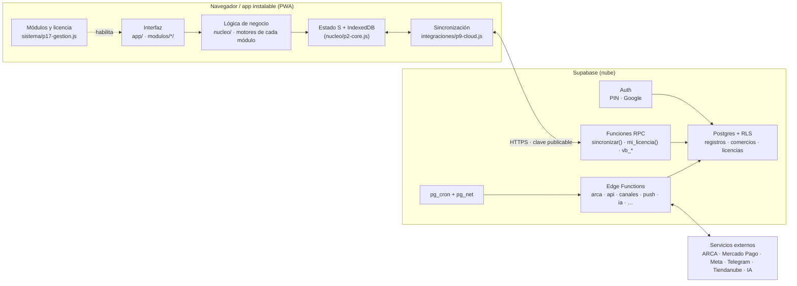

# Sistema Vincular Business (Sistema VB)

Sistema de gestión integral para comercios: punto de venta, caja, inventario, clientes y Club de fidelización, compras, personal, reparto, atención al cliente omnicanal, finanzas, facturación electrónica ARCA y asistentes con IA, en una sola plataforma **modular**. Cada comercio activa solo los módulos que contrató.

- **Cliente en producción:** Almacén y Licorería RAVE (perfil `cliente`, publicado en GitHub Pages).
- **Funciona sin internet:** guarda todo en el dispositivo (IndexedDB) y sincroniza con la nube (Supabase) cuando vuelve la conexión.
- **Un solo archivo publicado:** `index.html`. El menú digital público está adelante; el panel del equipo está en `/#acceso`.

| | |
|---|---|
| Versión de la aplicación | V26.79 · historial completo en [`fuente/docs/CHANGELOG.md`](fuente/docs/CHANGELOG.md) |
| Versión de la base de datos | 33 (`vb_version()`), migraciones `supabase/01…33` |
| Pruebas | 846 pruebas SQL + 116 suites de navegador (Playwright) |

---

## 1. Arquitectura



**Capas**

| Capa | Dónde | Responsabilidad |
|---|---|---|
| Interfaz | `app/`, pantallas de cada `modulos/<área>/` (`SCREENS.x.render`) | Dibujar pantallas, leer formularios, atajos y accesibilidad. No calcula dinero ni stock por su cuenta. |
| Lógica de negocio | `nucleo/p3-ops.js` (arqueo, reparto, reportes), motores dentro de cada módulo (`priceResolve`, `vbOrderCreate`, `dlMove`, `ivClose`, compras, balanza) | Reglas del comercio, siempre en **centavos**. Funciones puras donde es posible (p. ej. `p7c-scale.js`). |
| Datos | `nucleo/p2-core.js` (estado `S`, `save()`, IndexedDB), `integraciones/p9-cloud.js` (sincronización), `supabase/*.sql` | Guardar, sincronizar y validar. La base revalida todo con RLS: el navegador nunca es la autoridad. |
| Integraciones | `integraciones/`, `supabase/functions/` | ARCA, Tiendanube, canales de mensajería, push, Mercado Pago e IA. Las claves secretas viven **solo** como secretos de Supabase. |

**Flujo de una venta:** Vender (interfaz) → `priceResolve` y cobro (lógica) → `save('sale')` en IndexedDB (datos) → cola de sincronización → `sincronizar()` en Supabase, que verifica el rol y el comercio con RLS y lo guarda en `registros` → los demás dispositivos lo reciben.

**Módulos y licencias:** cada función tiene una clave en `GI_MODS` (`sistema/p17-gestion.js`). El administrador la activa en *Sistema → Módulos*. La licencia del comercio (`mi_licencia()`, versión 33 de la base) registra el combo de la web (Menú, Básico, Completo, Completo + App o a medida), los extras contratados (Pro + IA, NFC, turnos…) y el vencimiento del mantenimiento mensual. **La licencia nunca bloquea:** si el mantenimiento no está al día, el sistema solo muestra un aviso (`bloquea = false`). Si un comercio no tiene licencia cargada, funciona sin restricciones; así está hoy Almacén RAVE.

## 2. Estructura del repositorio

```
index.html, sw.js, app*.png, *.webmanifest   ← lo publicado (generado por fuente/build.py)
fuente/
  build.py            arma index.html para un perfil (demo | cliente | kini | solo | v3)
  assemble.py         arma el menú público (pub/ → build/p0-pub.js)
  gen_data.py         catálogo y datos de ejemplo (build/p0-data.js)
  app/                cabecera HTML y estilos, PWA, experiencia de uso (Ctrl + K, pestañas), tablas ordenables, asistente
  nucleo/             estado, utilidades, almacenamiento y cálculos base
  sistema/            registro de módulos, planes y paquetes (Gestión integral)
  modulos/
    ventas/           POS, recargos por medio de pago, combos, presupuestos y devoluciones, pantalla del cliente
    caja/             cajas y sucursales, cortes X/Z, traspasos, cobros digitales, expediente, cierre por rubro
    perfiles/         modo de comercio: un solo dueño, demo Kini, demo genérica
    clientes-club/    clientes, Club y fidelización, fiado y cuenta corriente, wallet, sello NFC, push, app del Club
    atencion-cliente/ CRM omnicanal, Omni-Assist, canales, pipeline de ventas
    mayorista/        listas y precios mayoristas, pedidos, remitos, acopio, preventa, GPS, bot, portal B2B
    inventario/       depósitos y transferencias, toma de inventario, etiquetas y precios
    compras/          proveedores, órdenes de compra, recepción, lectura de facturas
    personal/         fichaje, Recursos Humanos, seguridad y portero
    reparto/          reparto y despacho, hoja de ruta
    finanzas/         Resumen y gráficos, finanzas y contabilidad
    perifericos/      impresoras, cajón, balanzas, NFC
    legal/            textos legales y lista de verificación
    canal-digital/    menú público, tienda, secciones, ventas online
    centro-inteligente/ Centro Inteligente, equipo R2AVE, centro vivo, Telegram
  integraciones/      nube (Supabase), ARCA, Tiendanube
  pub/                fuente del menú público (HTML, CSS y JS)
  assets/             imágenes de marca
  pruebas/            pruebas de navegador (Playwright)
  docs/               historial de versiones y prompts anteriores
supabase/
  01…33-*.sql         migraciones numeradas, aditivas e idempotentes
  INSTALAR-TODO.sql   01…32 en un solo archivo (proyecto nuevo)
  functions/          Edge Functions (Deno/TypeScript)
  tests/              pruebas SQL (run.sh) y concurrencia
instalador/           instalador de escritorio para Windows (Go)
```

Los archivos conservan su prefijo `pNN`. El **orden de armado** está en la lista `parts` de `build.py`, no en la carpeta: el sistema se arma concatenando las partes en un único script. Cada parte se busca por su nombre (`SRC`), así que un archivo se puede mover de carpeta sin cambiar nada más. Un nombre repetido en dos carpetas corta la compilación.

## 3. Puesta en marcha paso a paso

**Requisitos:** Python 3.10 o superior (con Pillow), Node 18 o superior (solo para `node --check`), Git. Para las pruebas: Playwright con Chromium, OpenCV y PostgreSQL 15 o superior.

1. **Clonar**
   ```bash
   git clone https://github.com/raveholding/AlmacenRAVE.git && cd AlmacenRAVE/fuente
   ```
2. **Compilar una demo sin nube** (abre el archivo en el navegador; no necesita servidor)
   ```bash
   python3 build.py demo /tmp/demo/index.html
   ```
3. **Crear la nube** (proyecto nuevo de Supabase): en *SQL Editor*, pegar y ejecutar `supabase/INSTALAR-TODO.sql`. Comprobar con `select vb_version();` → `33`. Pasos detallados en [`supabase/LEEME-supabase.md`](supabase/LEEME-supabase.md); el ingreso con Google, en [`supabase/LEEME-google.md`](supabase/LEEME-google.md).
4. **Compilar el cliente conectado a la nube**
   ```bash
   SUPABASE_URL=https://<proyecto>.supabase.co SUPABASE_KEY=sb_publishable_… \
   RAVE_SLUG=almacen-rave PUBLIC_URL=https://raveholding.github.io/AlmacenRAVE/ \
   python3 build.py cliente ../index.html
   ```
   `build.py` **rechaza** una clave secreta (`service_role` o `sb_secret_…`).
5. **Edge Functions** (opcionales, según el módulo): desplegar con `supabase functions deploy <nombre>` y cargar sus secretos con `supabase secrets set NOMBRE=valor`. Ver la sección 4.
6. **Publicar:** confirmar `index.html`, `sw.js`, los íconos y los manifiestos en la raíz. GitHub Pages los publica solo.
7. **Primer ingreso:** `/#acceso` → crear el administrador → *Sistema → Módulos* para activar lo contratado.

**Pruebas**
```bash
bash supabase/tests/run.sh               # base de datos: aplica 01…33 dos veces y corre las pruebas SQL
python3 fuente/build.py kini /tmp/rave/kini.html
python3 fuente/build.py cliente /tmp/rave/out_cliente.html
python3 fuente/pruebas/vb1.py            # cada suite imprime OK / FALLA por verificación
```

## 4. Variables de entorno

### Compilación (`fuente/build.py`)

| Variable | Obligatoria | Descripción |
|---|---|---|
| `SUPABASE_URL` | En `cliente` | URL del proyecto (`https://<ref>.supabase.co`). En las demos se ignora. |
| `SUPABASE_KEY` | En `cliente` | Clave **publicable** (`sb_publishable_…`). Nunca la secreta. |
| `RAVE_SLUG` | No | Identificador del comercio (por defecto `almacen-rave`). |
| `PUBLIC_URL` | No | Dirección pública del sistema (canónica, QR y enlaces). |
| `GI` | No | `1` fuerza y `0` saca la Gestión integral (pruebas). |
| `CI` | No | `1` fuerza el Centro Inteligente en perfiles que no lo llevan. |
| `R2AVE`, `TG` | No | `0` saca, `1` fuerza el equipo R2AVE o R2AVE en Telegram. |
| `KINI_LOGO`, `KINI_C1…C3` | No | Logo y colores de la marca de la demo mayorista. |

### Edge Functions (secretos de Supabase)

Todas usan `SUPABASE_URL`, `SUPABASE_ANON_KEY` y `SUPABASE_SERVICE_ROLE_KEY`. Supabase las inyecta solo: no se cargan a mano. `ALLOWED_ORIGINS` limita qué sitios pueden llamarlas (p. ej. `https://raveholding.github.io`).

| Función | Secretos propios |
|---|---|
| `arca` | `ARCA_MASTER_KEY` (cifra el certificado del comercio) |
| `llave` | `LLAVE_MASTER_KEY` (custodia de claves) |
| `tiendanube` | `TN_APP_ID`, `TN_CLIENT_SECRET`, `TN_MASTER_KEY` |
| `canales` | `WA_TOKEN`, `WA_PHONE_ID`, `META_APP_SECRET`, `META_PAGE_TOKEN`, `META_VERIFY_TOKEN`, `TG_CLIENTES_TOKEN`, `TG_CLIENTES_SECRET`, `RESEND_API_KEY`, `MAIL_FROM`, `MAIL_IN_SECRET`, `OAUTH_KEY`, `CANALES_COMERCIO` |
| `conectar` | `META_APP_ID`, `META_APP_SECRET`, `META_CONFIG_ID`, `GOOGLE_CLIENT_ID`, `GOOGLE_CLIENT_SECRET`, `MS_CLIENT_ID`, `MS_CLIENT_SECRET`, `MS_TENANT`, `OAUTH_KEY` |
| `telegram` | `TELEGRAM_BOT_TOKEN`, `TELEGRAM_WEBHOOK_SECRET`, `TG_COMERCIO`, `ANTHROPIC_API_KEY` (opcional), `TG_AI_MODEL` |
| `ia` | `OPENAI_API_KEY` o `GEMINI_API_KEY`, `IA_MODELO`, `IA_LIMITE_HORA` |
| `leer-factura` | `ANTHROPIC_API_KEY`, `AI_MODEL`, `AI_MAX_DAY` |
| `mpago` | `MP_ACCESS_TOKEN`, `MP_WEBHOOK_SECRET`, `MP_COMERCIO` |
| `reparto-pro` | `GOOGLE_ROUTES_KEY`, `MP_ACCESS_TOKEN`, `MP_WEBHOOK_SECRET`, `WA_TOKEN`, `WA_PHONE_ID`, `WA_TEMPLATE`, `WA_LANG` |
| `push` | `VAPID_SUB` (las claves VAPID se generan y guardan en la base) |
| `api`, `eventos` | Solo las comunes |

## 5. Convenciones de código

**Idioma y textos**
- La interfaz está en español rioplatense, con palabras del comercio («Vender», «Caja», «Fiado»). Nada de jerga técnica en pantalla.
- Los comentarios de cada archivo empiezan con un bloque `/* ===== Vxx · Tema ===== */` que dice qué hace el archivo y desde qué versión.

**Dinero, fechas y datos**
- Todo importe se guarda en **centavos enteros**. Se muestra con `money()`. No se usan decimales de punto flotante en cálculos.
- Cada colección nueva se agrega en tres lugares a la vez: en el cliente (`COLS`), en la lista cerrada de `sincronizar()` y en los permisos de `rave_puede_escribir()`. El cliente solo la envía cuando `vb_version()` confirma que la nube la soporta.
- Toda acción sensible deja una entrada en la auditoría (`audit()`). En el servidor, la auditoría no se puede modificar.

**Estructura del JavaScript**
- Un único ámbito global con `'use strict'`. Cada módulo usa un **prefijo propio** para no chocar: `gi` módulos, `lb` etiquetas, `vbOrder`/`vbRemito` mayorista, `dp` depósitos, `iv` inventario, `pv` preventa, `dl` pipeline, `crm` atención al cliente.
- Para extender sin romper, se envuelve la función original: `const _x = x; x = function(...a){ const r = _x(...a); /* extra */ return r; }`. Las `const` no se pueden envolver: se extienden por otro punto.
- Cada módulo nuevo se registra en `GI_MODS` y nace **apagado**. Si no está activo, no dibuja ni ejecuta nada.

**Base de datos**
- Las migraciones van numeradas, son **aditivas e idempotentes** (`create … if not exists`, `create or replace`) y no borran datos. Cada una sube `vb_version()`.
- Las tablas tienen RLS y no se leen directo: el acceso es por funciones `security definer` con `set search_path = public` que verifican `rol_en(comercio)`.
- Antes de aplicar en producción: pruebas en local con `run.sh` (dos pasadas), autorización del dueño y verificación posterior.

**Seguridad**
- Nunca hay claves secretas en el código, en el HTML ni en los chats. Solo la clave publicable va al navegador.
- Los números de tarjeta (validados con Luhn), el CVV y el PIN se bloquean en los chats y se enmascaran.
- La ubicación GPS se usa solo con consentimiento explícito.

**Pruebas**
- Cada función nueva lleva su suite en `fuente/pruebas/` con **números conocidos calculados por separado**, y su prueba SQL en `supabase/tests/`.
- Una reorganización tiene que producir un `index.html` **idéntico byte por byte** al anterior en todos los perfiles.

## 6. Perfiles de compilación

| Perfil | Publicado en | Qué es |
|---|---|---|
| `cliente` | AlmacenRAVE | Sistema real, con la nube. Gestión integral incluida y apagada hasta activarla. |
| `demo` | — | Demo local sin nube. |
| `solo` | raveV2 | Comercio genérico de un solo dueño. |
| `v3` | raveV3 | Empresa con el equipo R2AVE. |
| `kini` | KiniDistribuidoraDemo | Demo mayorista (en retiro). |

## 7. Créditos

Vincular Business · (387) 4484132 · vincularbusiness@gmail.com
